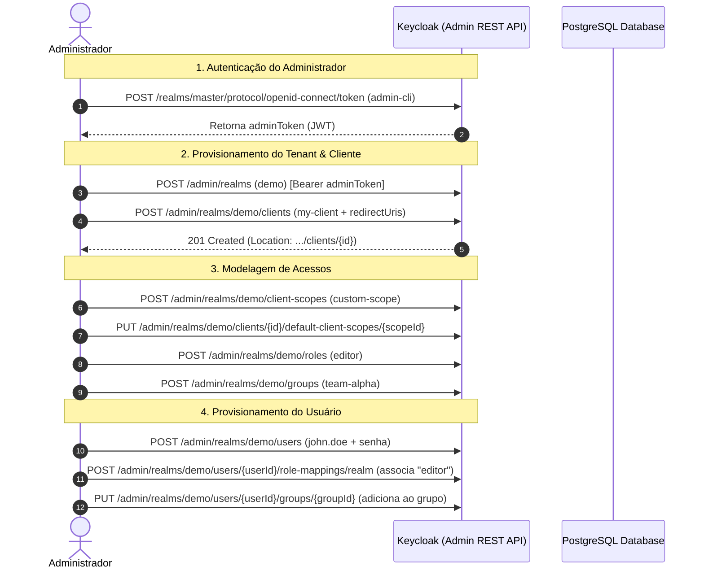
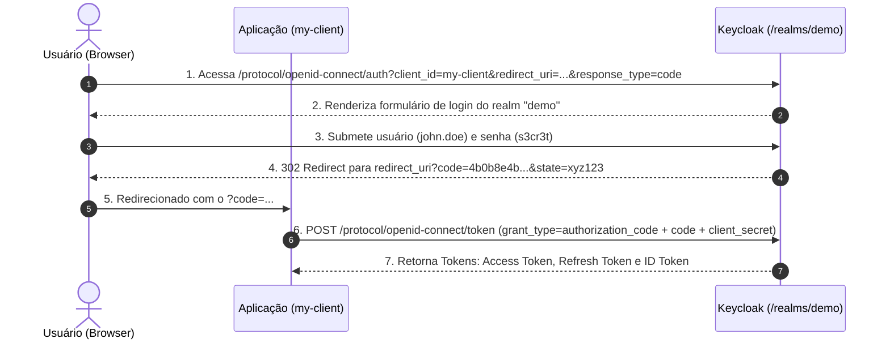

# Arquitetura, Conceitos e Fluxos do Keycloak

Este documento consolida os conceitos fundamentais do **Keycloak**, a hierarquia de objetos (Multi-Tenancy, IAM e RBAC) e os fluxos práticos de autenticação e administração validados nos arquivos [`default-reqs.http`](file:///home/vini0410/code/basic-learning/deep-learning/keycloak/default-reqs.http) e [`client-oidc-reqs.http`](file:///home/vini0410/code/basic-learning/deep-learning/keycloak/client-oidc-reqs.http).

---

## 1. O que é o Keycloak?

O Keycloak é uma solução de **Gerenciamento de Identidades e Acesso (IAM - Identity and Access Management)** de código aberto mantida pela Red Hat/comunidade Quarkus. Ele atua como um **Identity Provider (IdP)** e **Authorization Server**, fornecendo:

- **Single Sign-On (SSO)** e Single Sign-Out centralizados.
- Padrões de mercado: **OAuth 2.0**, **OpenID Connect (OIDC)** e **SAML 2.0**.
- **User Federation**: sincronização com LDAP / Active Directory.
- **Identity Brokering**: login social (Google, GitHub, Facebook) ou corporativo (SAML/OIDC externo).
- Controle de acesso baseado em funções (**RBAC**) e grupos.
- Extensibilidade total via **SPIs (Service Provider Interfaces)**.

---

## 2. Hierarquia e Modelo de Objetos

No Keycloak, todos os recursos existem dentro de um modelo hierárquico estrito:

```
Keycloak Server Instance
 ├── Realm: "master" (Super-administração do cluster/instância)
 │    ├── Clients (admin-cli, security-admin-console, etc.)
 │    └── Admin Users (admin)
 │
 └── Realm: "demo" (Ambiente de negócio isolado / Tenant)
      ├── Clients
      │    └── "my-client" (Aplicação / API / SPA)
      │         ├── Client Scopes ("custom-scope", openid, profile, email)
      │         └── Service Account (M2M Identity)
      │
      ├── Roles (RBAC)
      │    ├── Realm Roles ("editor", "viewer")
      │    └── Client Roles ("my-client:read", "my-client:write")
      │
      ├── Groups ("team-alpha", "engineering")
      │    └── Hierarquia de subgrupos e herança de roles
      │
      └── Users ("john.doe")
           ├── Credentials (senha, OTP/MFA, webauthn)
           ├── User Attributes (email, nome, custom claims)
           ├── Direct Role Mappings
           └── Group Memberships
```

### Detalhamento dos Componentes

### A. Realm (Tenant)
- É a unidade primária de isolamento (**Multi-tenancy**).
- Usuários, credenciais, roles e clientes cadastrados no realm `demo` **não existem** no realm `master` ou em qualquer outro realm.
- **Realm `master`**: Criado na instalação exclusivamente para administrar a instância e gerenciar outros realms. Nunca coloque usuários finais de negócio no `master`.

### B. Client (Aplicação Consumidora)
- Representa um sistema que delega a autenticação ao Keycloak (um frontend SPA, app mobile, backend API ou daemon job).
- **Tipos principais**:
  - **Confidential Client**: Aplicações com backend seguro capazes de guardar um segredo (`client_secret`).
  - **Public Client**: Aplicações client-side (SPA React/Angular, mobile apps) que não conseguem guardar segredos em segurança (usam PKCE).
  - **Bearer-Only**: APIs que nunca iniciam login, apenas recebem e validam tokens JWT nas requisições.
- **Flows Habilitados por Cliente**:
  - `standardFlowEnabled`: Habilita o Authorization Code Flow (navegador).
  - `directAccessGrantsEnabled`: Habilita Resource Owner Password Credentials (login direto usuário/senha via API).
  - `serviceAccountsEnabled`: Habilita Client Credentials Flow (M2M).

### C. Client Scopes
- Mecanismo que define quais **claims** (dados) ou permissões são inseridos no token gerado para os clientes.
- Podem ser associados como:
  - **Default**: Sempre incluídos no token.
  - **Optional**: Incluídos apenas se requisitados explicitamente no parâmetro `scope=...`.

### D. Identity & Access (Users, Roles e Groups)
- **Users**: As identidades finais que se autenticam.
- **Realm Roles**: Papéis globais dentro daquele realm (ex.: `editor`).
- **Client Roles**: Papéis específicos de um cliente específico (ex.: `my-client` -> `admin`).
- **Groups**: Agrupamento lógico de usuários. Permitem herança de roles e atributos para todos os seus membros.

---

## 3. Os Dois Grandes Fluxos do Projeto

O projeto foi dividido em duas perspectivas bem definidas:

```
[Administrador / DevOps]                      [Aplicação / Usuário Final]
           │                                                │
           ▼                                                ▼
  default-reqs.http                               client-oidc-reqs.http
(Admin REST API - Porta 8080)                  (OIDC Endpoints - Porta 8080)
           │                                                │
           ├─ 1. Login no Master (admin-cli)                ├─ 1. OIDC Discovery & JWKS
           ├─ 2. Criar Realm "demo"                         ├─ 2. Auth Code Flow (Browser login)
           ├─ 3. Criar Client "my-client"                   ├─ 3. Client Credentials Flow (M2M)
           ├─ 4. Criar Roles & Groups                       ├─ 4. Password Grant Flow (Direct)
           └─ 5. Criar User "john.doe"                      ├─ 5. UserInfo & Token Introspect
                                                            └─ 6. Refresh Token & Logout
```

---

## 4. Fluxo de Administração (Provisionamento via Admin API)

Implementado em [`default-reqs.http`](file:///home/vini0410/code/basic-learning/deep-learning/keycloak/default-reqs.http):



### Regras Críticas Aprendidas no Provisionamento:
1. **Header `Location`**: Criar entidades (Client, Scope, User, Group) retorna HTTP `201 Created` sem corpo JSON. O ID gerado fica no cabeçalho HTTP `Location`.
2. **`redirectUris` Obrigatório**: Um cliente só aceitará login por navegador se possuir URLs de retorno registradas (ex: `http://localhost:8080/callback`).
3. **Role Mapping Exige ID + Nome**: O endpoint de associar role ao usuário requer array com objeto contendo `id` e `name` (não apenas o nome da role).

---

## 5. Fluxos de Consumo da Aplicação (OIDC & OAuth 2.0)

Implementado em [`client-oidc-reqs.http`](file:///home/vini0410/code/basic-learning/deep-learning/keycloak/client-oidc-reqs.http):

### Fluxo 1: Authorization Code Flow (Padrão Web / Navegador)

É o fluxo mais seguro e recomendado para aplicações web e móveis:



### Fluxo 2: Client Credentials Flow (Máquina para Máquina - M2M)

Usado por microsserviços e tarefas assíncronas que atuam em nome do próprio serviço:
```http
POST /realms/demo/protocol/openid-connect/token
grant_type=client_credentials&client_id=my-client&client_secret=my-secret
```
- Retorna um `access_token` contendo as roles e atributos da **Service Account** do cliente.

### Fluxo 3: Token Introspection (RFC 7662 - Validação em APIs)

Usado por um Resource Server (sua API backend) para verificar se o token recebido ainda é válido:
```http
POST /realms/demo/protocol/openid-connect/token/introspect
token=<USER_ACCESS_TOKEN>&client_id=my-client&client_secret=my-secret
```
- **Importante**: O introspect exige autenticação do **próprio client** (`client_id` + `client_secret`), não do usuário nem do admin master. Retorna `{"active": true, "sub": "...", "scope": "..."}`.

### Fluxo 4: Ciclo de Vida do Token (Refresh & Revocation)

- **Refresh Token**: Renova o access token expirado sem incomodar o usuário:
  `grant_type=refresh_token&refresh_token=...`
- **Revoke (RFC 7009)**: Invalida explicitamente um refresh token antes do seu prazo natural:
  `POST /realms/demo/protocol/openid-connect/revoke`
- **Logout (RP-Initiated)**: Encerra todas as sessões SSO do usuário no servidor:
  `POST /realms/demo/protocol/openid-connect/logout`

---

## 6. Resumo das Práticas Recomendadas

| Assunto | Prática Recomendada |
|---|---|
| **Ambientes** | Isole cada aplicação/sistema em seu próprio **Realm**. Use o realm `master` exclusivamente para tarefas administrativas de infraestrutura. |
| **Nomes de Variáveis HTTP** | Separe chamadas com `###`, use `# @name <nome>` para permitir encadeamento automático (`{{nome.response.body.campo}}`) sem scripts globais. |
| **Form Data URL-Encoded** | Não utilize espaços entre `=` ou `&` (ex: `grant_type=password&...`) para evitar caracteres espúrios no parsing do Keycloak. |
| **Segurança no Browser** | Para fluxos com frontend público, utilize sempre **PKCE** (`code_challenge` / `code_verifier`) e `publicClient: true`. |
| **Validação de Token em APIs** | Prefira validar tokens JWT localmente através das chaves públicas obtidas no endpoint `/certs` (JWKS), deixando o endpoint `/introspect` para cenários que exigem checagem de revogação em tempo real. |
