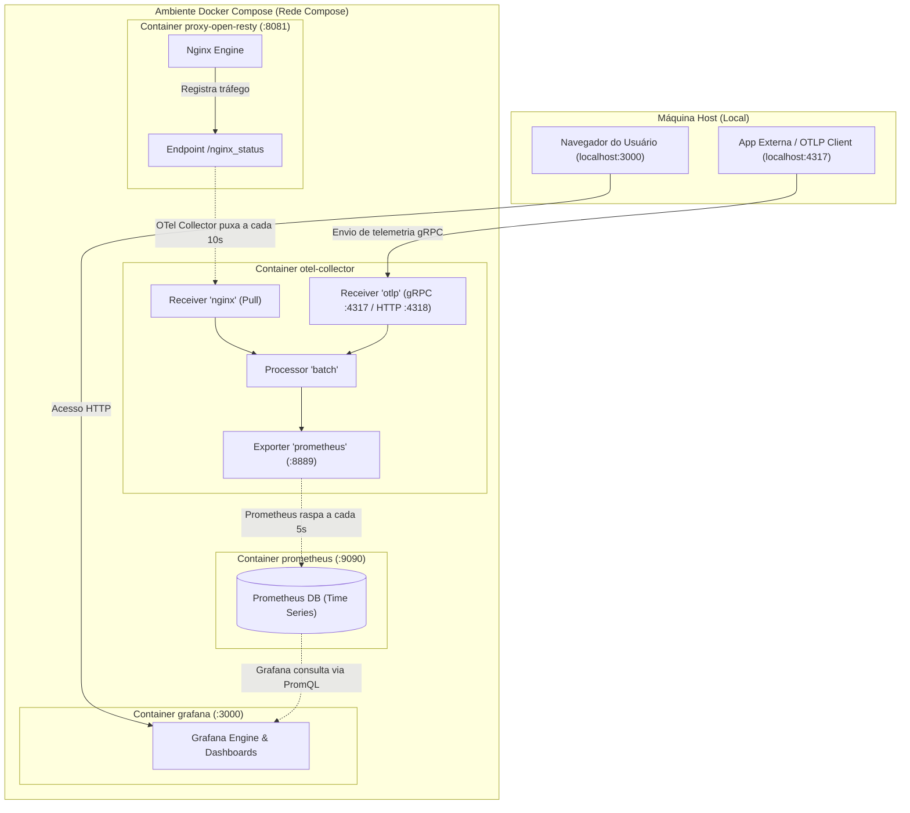
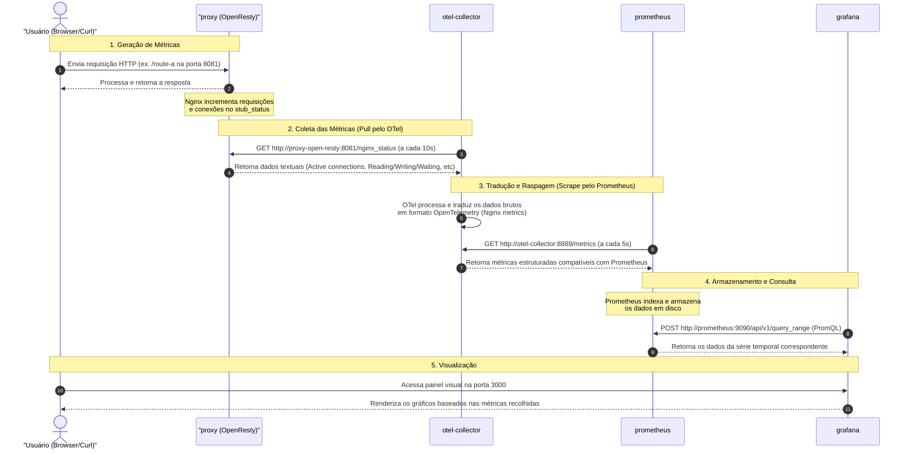

# Plano de Telemetria (Nginx + OpenTelemetry Collector + Prometheus + Grafana)

Este plano descreve como configurar a coleta de métricas do proxy **OpenResty (Nginx)** e centralizá-las no **Grafana** usando o **OpenTelemetry (OTel) Collector** e **Prometheus** como backend de armazenamento. Toda a configuração é projetada para rodar localmente no Docker.

---

## 1. Arquitetura da Solução

O fluxo de dados de métricas seguirá o seguinte caminho:

```
[ OpenResty (Nginx) ]
      │ (expõe /nginx_status)
      ▼
[ OTel Collector ] (nginx receiver) ──► (otlp/grpc :4317 para outras fontes)
      │ (prometheus exporter na :8889)
      ▼
[ Prometheus ] (raspa métricas do OTel Collector na :8889)
      ▲
      │ (consulta dados)
[ Grafana ] (dashboard de visualização)
```

### Detalhes Importantes:
* **Nginx/OpenResty Metrics:** O Nginx não envia métricas ativamente via OTLP/gRPC por padrão (o módulo OTel do Nginx envia principalmente *traces*). Por isso, usaremos o **nginx receiver** do OTel Collector para raspar as métricas do endpoint `/nginx_status` do OpenResty.
* **OTLP gRPC Receiver (`localhost:4317`):** O OTel Collector será configurado para expor a porta `4317` (gRPC) no host (`localhost:4317`), permitindo que outras aplicações no futuro enviem métricas/rastros diretamente a ele.
* **Prometheus:** Servirá como o banco de dados de séries temporais. O OTel Collector irá expor as métricas raspadas do Nginx no formato do Prometheus, que por sua vez raspará o Collector.
* **Grafana:** Conectará ao Prometheus para criar os painéis visuais.

---

## 2. Passo a Passo de Modificações e Novos Arquivos

### Passo 2.1: Atualizar o OpenResty para Expor as Métricas
Precisamos habilitar o módulo `stub_status` no OpenResty para expor as métricas nativas do Nginx.

Modificar o arquivo: [open-resty/nginx.conf.template](file:///home/vini0410/code/basic-learning/deep-learning/proxy/nginx-test/open-resty/nginx.conf.template)
Adicionar o bloco `location /nginx_status` dentro do bloco `server`:

```nginx
        # Endpoint de métricas internas do Nginx
        location /nginx_status {
            stub_status on;
            access_log off;
            allow all; # Em produção, limitar aos IPs permitidos (ex: OTel Collector)
        }
```

### Passo 2.2: Criar Configuração do OpenTelemetry Collector
Criar o arquivo `otel-collector-config.yaml` na raiz do projeto para configurar o OTel Collector com suporte a gRPC e recebimento de métricas do Nginx.

Criar o arquivo: [otel-collector-config.yaml](file:///home/vini0410/code/basic-learning/deep-learning/proxy/nginx-test/otel-collector-config.yaml)

```yaml
receivers:
  # Receptor OTLP (exposto em gRPC na 4317 e HTTP na 4318)
  otlp:
    protocols:
      grpc:
        endpoint: 0.0.0.0:4317
      http:
        endpoint: 0.0.0.0:4318

  # Receptor Nginx para raspar o stub_status exposto
  nginx:
    endpoint: http://proxy-open-resty:8081/nginx_status
    collection_interval: 10s

processors:
  batch:

exporters:
  # Exporta métricas em formato raspável pelo Prometheus
  prometheus:
    endpoint: 0.0.0.0:8889
    namespace: "nginx"

  # Útil para debug local nos logs do container do collector
  debug:
    verbosity: basic

service:
  pipelines:
    metrics:
      receivers: [otlp, nginx]
      processors: [batch]
      exporters: [prometheus, debug]
```

### Passo 2.3: Criar Configuração do Prometheus
Criar o arquivo `prometheus.yml` para orientar o Prometheus a coletar métricas do OTel Collector.

Criar o arquivo: [prometheus.yml](file:///home/vini0410/code/basic-learning/deep-learning/proxy/nginx-test/prometheus.yml)

```yaml
global:
  scrape_interval: 5s # Intervalo curto para testes rápidos locais

scrape_configs:
  - job_name: 'otel-collector'
    static_configs:
      - targets: ['otel-collector:8889']
```

### Passo 2.4: Provisionamento de Datasource no Grafana (Opcional, mas Recomendado)
Para evitar ter que configurar o Prometheus como datasource manualmente no Grafana, podemos provisioná-lo via código.

Criar o arquivo: [grafana/provisioning/datasources/datasource.yml](file:///home/vini0410/code/basic-learning/deep-learning/proxy/nginx-test/grafana/provisioning/datasources/datasource.yml)

```yaml
apiVersion: 1

datasources:
  - name: Prometheus
    type: prometheus
    access: proxy
    url: http://prometheus:9090
    isDefault: true
    editable: true
```

### Passo 2.5: Atualizar o Docker Compose
Adicionar os serviços `otel-collector`, `prometheus` e `grafana` no arquivo `docker-compose.yml`.

Modificar o arquivo: [docker-compose.yml](file:///home/vini0410/code/basic-learning/deep-learning/proxy/nginx-test/docker-compose.yml)

```yaml
services:
  service:
    build:
      context: ./service
      network: host
    container_name: flask-service
    environment:
      PORT: 5000
    ports:
      - "5000:5000"

  proxy-open-resty:
    build:
      context: ./open-resty
      network: host
    container_name: proxy
    depends_on:
      - service
    environment:
      UPSTREAM_HOST: service
      UPSTREAM_PORT: 5000
    ports:
      - "8081:8081"

  otel-collector:
    image: otel/opentelemetry-collector-contrib:latest
    container_name: otel-collector
    command: ["--config=/etc/otelcol-contrib/config.yaml"]
    volumes:
      - ./otel-collector-config.yaml:/etc/otelcol-contrib/config.yaml
    ports:
      - "4317:4317" # Porta gRPC solicitada exposta no localhost
      - "4318:4318" # Porta HTTP
      - "8889:8889" # Porta de exportação do Prometheus
    depends_on:
      - proxy-open-resty

  prometheus:
    image: prom/prometheus:latest
    container_name: prometheus
    volumes:
      - ./prometheus.yml:/etc/prometheus/prometheus.yml
    ports:
      - "9090:9090"
    depends_on:
      - otel-collector

  grafana:
    image: grafana/grafana:latest
    container_name: grafana
    environment:
      - GF_SECURITY_ADMIN_PASSWORD=admin # Senha padrão do admin
      - GF_USERS_ALLOW_SIGN_UP=false
    volumes:
      - ./grafana/provisioning:/etc/grafana/provisioning
    ports:
      - "3000:3000"
    depends_on:
      - prometheus
```

---

## 3. Como Executar e Validar

1. **Subir os containers:**
   ```bash
   docker compose up --build -d
   ```

2. **Gerar tráfego de teste:**
   Rode o script de testes existente para gerar requisições e alimentar as métricas do Nginx:
   ```bash
   python test_proxy.py
   ```

3. **Verificar os serviços:**
   * **Endpoint de status do Nginx:** Acesse [http://localhost:8081/nginx_status](http://localhost:8081/nginx_status) e verifique se exibe dados de conexões.
   * **Métricas brutas no OTel Collector:** Acesse [http://localhost:8889/metrics](http://localhost:8889/metrics) para ver o formato Prometheus exportado pelo Collector. Procure por `nginx_connections_active` ou `nginx_connections_accepted`.
   * **Prometheus:** Acesse [http://localhost:9090](http://localhost:9090), vá em "Status" > "Targets" e certifique-se de que o `otel-collector` está com status `UP`.
   * **Grafana:** Acesse [http://localhost:3000](http://localhost:3000) (Login: `admin` / Senha: `admin`).
     * O datasource **Prometheus** já estará configurado.
     * Você pode criar um painel simples de teste buscando a métrica `nginx_nginx_connections_active` ou importar um Dashboard pronto de Nginx da comunidade Grafana (ex: ID `12786` ou similar que leia do Prometheus).

---

## 4. Explicação Detalhada do Fluxo de Telemetria

Esta seção detalha o fluxo percorrido pelas métricas, desde a sua geração no servidor Nginx (OpenResty) até a sua exibição no painel do Grafana, passando pelo Collector e pelo banco de séries temporais.

### 4.1 Arquitetura e Fluxograma de Componentes

O diagrama abaixo ilustra o mapeamento de portas e a comunicação interna entre os containers do ambiente Docker:



### 4.2 Detalhamento do Fluxo Passo a Passo

O ciclo de vida de uma métrica de telemetria consiste nas seguintes fases:



### 4.3 Componentes do Fluxo e suas Responsabilidades

1. **Nginx (OpenResty - Porta 8081)**:
   * **Responsabilidade:** Proxy reverso da aplicação e gerador das métricas de tráfego brutas.
   * **Endpoint de Exposição:** `/nginx_status`.
   * **Como funciona:** O módulo nativo do Nginx `stub_status` mantém em memória contadores simplificados (conexões ativas, aceitas, manipuladas, taxa de requisições). Ele serve essas informações em formato de texto simples quando requisitado.

2. **OpenTelemetry Collector (Portas 4317, 4318, 8889)**:
   * **Responsabilidade:** Concentrar, padronizar e despachar os dados de telemetria.
   * **Receptor Nginx:** Executa um cliente HTTP que realiza polling periódico (a cada 10s) no endpoint `/nginx_status` do Nginx, convertendo as estatísticas de texto puro em métricas estruturadas do padrão OpenTelemetry.
   * **Receptor OTLP (gRPC :4317):** Fica ouvindo na porta de rede gRPC (mapeada no host em `localhost:4317`) permitindo que qualquer outra aplicação (como o backend Flask ou outros microserviços) possa enviar ativamente seus traces/métricas.
   * **Exportador Prometheus (Porta 8889):** Converte a base de métricas unificada do Collector e as disponibiliza na rota `/metrics` no formato do Prometheus.

3. **Prometheus (Porta 9090)**:
   * **Responsabilidade:** Banco de dados de série temporal (TSDB) e motor de regras de alerta.
   * **Como funciona:** Age no modelo *pull*. Ele faz chamadas periódicas (a cada 5s) à porta `8889` do OTel Collector, armazenando as métricas históricas indexadas por tags (labels).

4. **Grafana (Porta 3000)**:
   * **Responsabilidade:** Interface visual e criação de dashboards analíticos.
   * **Como funciona:** Consulta o banco do Prometheus por meio da linguagem PromQL. A cada atualização da tela, o Grafana faz requisições HTTP internas para `http://prometheus:9090` e renderiza os gráficos interativos para o usuário final.

---

## 5. Queries Grafana (PromQL)

As queries abaixo usam as métricas customizadas geradas pelo bloco Lua do OpenResty:
- `nginx_http_requests_total` — contador com labels `{host, status, path, method}`
- `nginx_http_request_duration_seconds` — histograma com labels `{host, path}`

> **Como usar no Grafana:** Crie um painel, selecione o datasource **Prometheus** e cole a query no campo **Metrics browser**. Para gráficos de taxa, use o tipo **Time series**; para valores únicos, use **Stat** ou **Gauge**.

---

### 5.1 Taxa de Sucesso Global (2xx)

Percentual de requisições com status 2xx sobre o total, janela de 1 minuto.

```promql
sum(rate(nginx_http_requests_total{status=~"2.."}[1m]))
/
sum(rate(nginx_http_requests_total[1m]))
* 100
```

> **Tipo de painel sugerido:** `Stat` ou `Gauge` com limiar: verde ≥ 99%, amarelo ≥ 95%, vermelho < 95%.

---

### 5.2 Taxa de Erros Global (4xx + 5xx)

Percentual de requisições com erro sobre o total.

```promql
sum(rate(nginx_http_requests_total{status=~"[45].."}[1m]))
/
sum(rate(nginx_http_requests_total[1m]))
* 100
```

> **Alternativa** — separando 4xx de 5xx em duas séries no mesmo gráfico:

```promql
# Série 1 — erros de cliente (4xx)
sum(rate(nginx_http_requests_total{status=~"4.."}[1m]))
/
sum(rate(nginx_http_requests_total[1m]))
* 100

# Série 2 — erros de servidor (5xx)
sum(rate(nginx_http_requests_total{status=~"5.."}[1m]))
/
sum(rate(nginx_http_requests_total[1m]))
* 100
```

---

### 5.3 Quantidade de Requisições por Rota (req/s)

Taxa de requisições por segundo, agrupada por `path`.

```promql
sum by (path) (
  rate(nginx_http_requests_total[1m])
)
```

> **Tipo de painel sugerido:** `Time series` com **Legend** = `{{path}}` para ver uma linha por rota.

Para ver o volume absoluto (total acumulado desde o início), sem `rate`:

```promql
sum by (path) (nginx_http_requests_total)
```

---

### 5.4 Sucesso por Rota (2xx/s por path)

```promql
sum by (path) (
  rate(nginx_http_requests_total{status=~"2.."}[1m])
)
```

---

### 5.5 Erros por Rota (4xx + 5xx por path)

```promql
sum by (path) (
  rate(nginx_http_requests_total{status=~"[45].."}[1m])
)
```

> **Dica:** Combine as duas queries no mesmo painel `Time series` para comparar sucesso vs. erro por rota lado a lado.

---

### 5.6 Taxa de Sucesso por Rota (%)

Percentual de 2xx dentro de cada `path` individualmente.

```promql
sum by (path) (rate(nginx_http_requests_total{status=~"2.."}[1m]))
/
sum by (path) (rate(nginx_http_requests_total[1m]))
* 100
```

---

### 5.7 Breakdown de Status por Rota

Todas as combinações de `path` × `status` de uma vez — útil para tabelas.

```promql
sum by (path, status) (
  rate(nginx_http_requests_total[1m])
)
```

> **Tipo de painel sugerido:** `Table` com colunas `path`, `status` e `Value` (req/s).

---

### 5.8 Latência Média por Rota (p50)

```promql
histogram_quantile(0.50,
  sum by (path, le) (
    rate(nginx_http_request_duration_seconds_bucket[1m])
  )
)
```

### 5.9 Latência p95 e p99 por Rota

```promql
# p95
histogram_quantile(0.95,
  sum by (path, le) (
    rate(nginx_http_request_duration_seconds_bucket[1m])
  )
)

# p99
histogram_quantile(0.99,
  sum by (path, le) (
    rate(nginx_http_request_duration_seconds_bucket[1m])
  )
)
```

> **Tipo de painel sugerido:** `Time series` com as três séries (p50, p95, p99) para visualizar a distribuição de latência ao longo do tempo.

---

### 5.10 Top 5 Rotas com Mais Erros

```promql
topk(5,
  sum by (path) (
    rate(nginx_http_requests_total{status=~"[45].."}[1m])
  )
)
```

---

### Resumo das Queries

| O que medir                        | Query resumida                                                                                 | Painel       |
|------------------------------------|-----------------------------------------------------------------------------------------------|--------------|
| Taxa de sucesso global (%)         | `sum(rate(...{status=~"2.."}[1m])) / sum(rate(...[1m])) * 100`                                | Stat / Gauge |
| Taxa de erros global (%)           | `sum(rate(...{status=~"[45].."}[1m])) / sum(rate(...[1m])) * 100`                             | Stat / Gauge |
| Reqs/s por rota                    | `sum by (path) (rate(nginx_http_requests_total[1m]))`                                         | Time series  |
| Sucesso/s por rota                 | `sum by (path) (rate(...{status=~"2.."}[1m]))`                                                | Time series  |
| Erros/s por rota                   | `sum by (path) (rate(...{status=~"[45].."}[1m]))`                                             | Time series  |
| % sucesso por rota                 | `sum by (path) (rate(...{status=~"2.."}[1m])) / sum by (path) (rate(...[1m])) * 100`          | Time series  |
| Status × rota (tabela)             | `sum by (path, status) (rate(nginx_http_requests_total[1m]))`                                 | Table        |
| Latência p50/p95/p99 por rota      | `histogram_quantile(0.9X, sum by (path, le) (rate(..._bucket[1m])))`                          | Time series  |
| Top 5 rotas com mais erros         | `topk(5, sum by (path) (rate(...{status=~"[45].."}[1m])))`                                    | Time series  |
