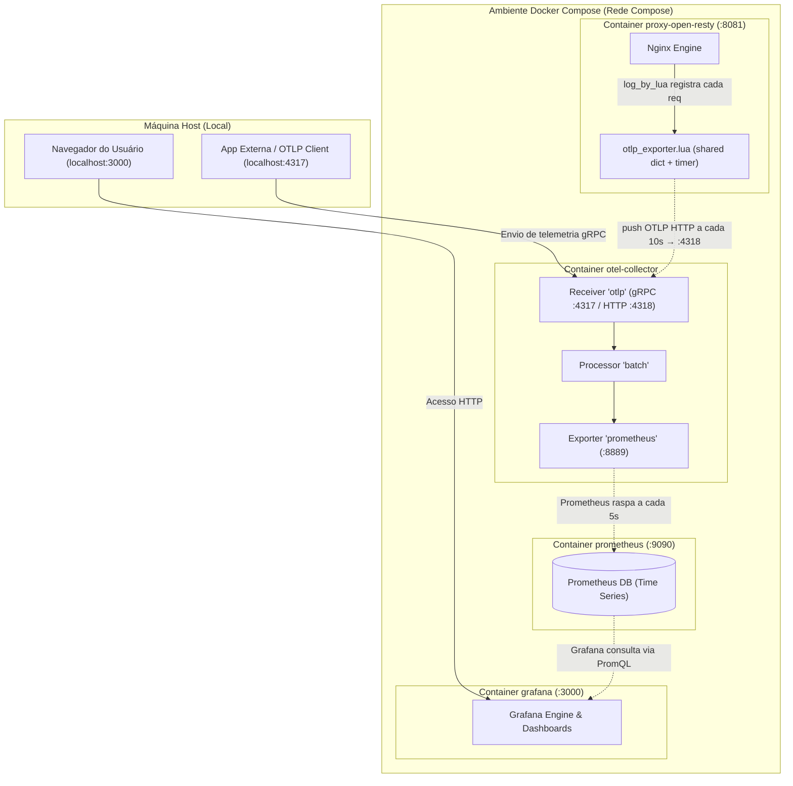
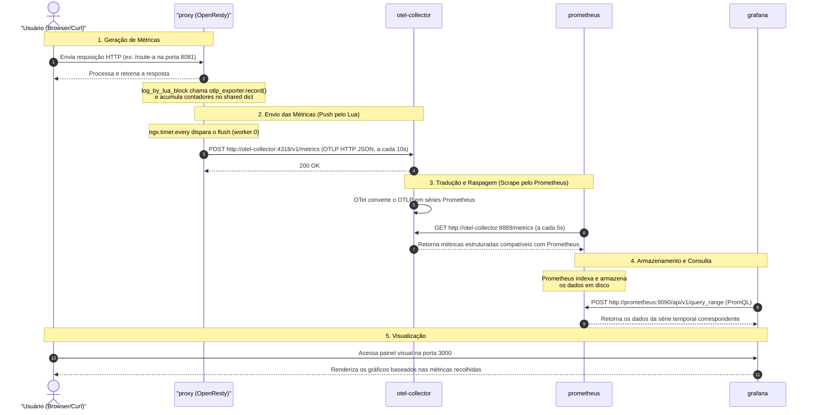

# Plano de Telemetria (Nginx + OpenTelemetry Collector + Prometheus + Grafana)

Este plano descreve como configurar a coleta de métricas do proxy **OpenResty (Nginx)** e centralizá-las no **Grafana** usando o **OpenTelemetry (OTel) Collector** e **Prometheus** como backend de armazenamento. Toda a configuração é projetada para rodar localmente no Docker.

---

## 1. Arquitetura da Solução

As métricas HTTP são geradas **dentro do próprio OpenResty** por um script Lua
([open-resty/otlp_exporter.lua](open-resty/otlp_exporter.lua)) que acumula os
contadores em memória e os **empurra (push)** periodicamente para o OTel Collector
via **OTLP HTTP/JSON** na porta `4318`. Não há mais scraping do `/nginx_status`.

```
[ OpenResty (Nginx + Lua) ]
      │ (push OTLP HTTP → :4318, a cada OTEL_FLUSH_INTERVAL s)
      ▼
[ OTel Collector ] (otlp receiver :4317 gRPC / :4318 HTTP)
      │ (prometheus exporter na :8889)
      ▼
[ Prometheus ] (raspa métricas do OTel Collector na :8889)
      ▲
      │ (consulta dados via PromQL)
[ Grafana ] (dashboards de visualização)
```

### Detalhes Importantes:
* **Geração das métricas (push):** O bloco `log_by_lua_block` chama `otlp_exporter.record()` a cada requisição, atualizando contadores num `lua_shared_dict`. Um `ngx.timer.every` (apenas no worker 0) monta o payload OTLP JSON e faz `POST /v1/metrics` para o Collector.
* **Métricas expostas:** `nginx_http_requests_total` (counter) e `nginx_http_request_duration_seconds` (histograma com buckets) — detalhadas na seção 5.
* **OTLP Receiver (`:4317` gRPC / `:4318` HTTP):** O Collector aceita tanto o push do proxy (HTTP :4318) quanto telemetria de outras aplicações (gRPC :4317).
* **Prometheus:** Raspa o Collector na porta `:8889` (formato Prometheus) e armazena as séries temporais.
* **Grafana:** Consulta o Prometheus via PromQL para montar os painéis.

---

## 2. Passo a Passo de Modificações e Novos Arquivos

### Passo 2.1: Exporter Lua no OpenResty (geração + push)
O arquivo [open-resty/otlp_exporter.lua](open-resty/otlp_exporter.lua) coleta as
métricas HTTP e as envia via OTLP HTTP. Ele é carregado no
[open-resty/nginx.conf.template](open-resty/nginx.conf.template):

```nginx
    # DNS interno do Docker — necessário para o resty.http resolver "otel-collector"
    resolver 127.0.0.11 ipv6=off valid=10s;

    # Acumulador dos contadores entre workers
    lua_shared_dict otlp_metrics 5M;

    init_worker_by_lua_block {
        require("otlp_exporter").init_timer()   -- agenda o flush (worker 0)
    }

    log_by_lua_block {
        local otlp = require("otlp_exporter")
        otlp.record(tostring(ngx.status), ngx.var.uri,
                    ngx.var.request_method, tonumber(ngx.var.request_time))
    }
```

> Não há mais `location /nginx_status` nem `location /metrics` no proxy — o scraping foi removido; tudo é enviado via push.

### Passo 2.2: Dependência Lua e variáveis (Dockerfile)
O [open-resty/Dockerfile](open-resty/Dockerfile) instala a lib HTTP usada no push e define os envs do exporter:

```dockerfile
RUN opm get ledgetech/lua-resty-http

ENV OTEL_ENDPOINT=http://otel-collector:4318   # destino do push (OTLP HTTP)
# OTEL_FLUSH_INTERVAL e OTEL_SERVICE_NAME podem ser definidos no compose
```

### Passo 2.3: OTel Collector (gateway)
Criar/editar o arquivo [otel-collector-gateway.yaml](otel-collector-gateway.yaml) para receber o push e expor no formato Prometheus:

```yaml
receivers:
  otlp:
    protocols:
      grpc:
        endpoint: 0.0.0.0:4317
      http:
        endpoint: 0.0.0.0:4318   # recebe o push do proxy (OTLP HTTP JSON)

processors:
  batch:

exporters:
  prometheus:
    endpoint: 0.0.0.0:8889       # Prometheus raspa aqui
    resource_to_telemetry_conversion:
      enabled: true
  debug:
    verbosity: basic

service:
  pipelines:
    metrics:
      receivers: [otlp]
      processors: [batch]
      exporters: [prometheus, debug]
```

### Passo 2.4: Configuração do Prometheus
O arquivo [prometheus.yml](prometheus.yml) orienta o Prometheus a raspar o OTel Collector:

```yaml
global:
  scrape_interval: 5s # Intervalo curto para testes rápidos locais

scrape_configs:
  - job_name: 'otel-collector'
    static_configs:
      - targets: ['otel-collector:8889']
```

### Passo 2.5: Provisionamento de Datasource no Grafana
O datasource Prometheus é provisionado automaticamente via
[grafana/provisioning/datasources/datasource.yml](grafana/provisioning/datasources/datasource.yml):

```yaml
apiVersion: 1

datasources:
  - name: Prometheus
    type: prometheus
    access: proxy
    url: http://prometheus:9090
    isDefault: true
    editable: true
```

O dashboard pronto para import fica em
[grafana/dashboards/nginx-proxy-dashboard.json](grafana/dashboards/nginx-proxy-dashboard.json)
(passo a passo de import na seção 6).

### Passo 2.6: Docker Compose
Os serviços `otel-collector`, `prometheus` e `grafana` já estão declarados no arquivo [docker-compose.yml](docker-compose.yml):

```yaml
services:
  service:
    build:
      context: ./service
      network: host
    container_name: flask-service
    environment:
      PORT: 5000
    ports:
      - "5000:5000"

  proxy-open-resty:
    build:
      context: ./open-resty
      network: host
    container_name: proxy
    depends_on:
      - service
    environment:
      UPSTREAM_HOST: service
      UPSTREAM_PORT: 5000
      OTEL_ENDPOINT: http://otel-collector:4318   # push das métricas via OTLP HTTP
      OTEL_FLUSH_INTERVAL: 10                      # flush a cada 10s
    ports:
      - "8081:8081"

  otel-collector:
    image: otel/opentelemetry-collector-contrib:latest
    container_name: otel-collector
    command: ["--config=/etc/otelcol-contrib/config.yaml"]
    volumes:
      - ./otel-collector-gateway.yaml:/etc/otelcol-contrib/config.yaml
    ports:
      - "4317:4317" # OTLP gRPC
      - "4318:4318" # OTLP HTTP (recebe o push do proxy)
      - "8889:8889" # Porta de exportação do Prometheus
    depends_on:
      - proxy-open-resty

  prometheus:
    image: prom/prometheus:latest
    container_name: prometheus
    volumes:
      - ./prometheus.yml:/etc/prometheus/prometheus.yml
    ports:
      - "9090:9090"
    depends_on:
      - otel-collector

  grafana:
    image: grafana/grafana:latest
    container_name: grafana
    environment:
      - GF_SECURITY_ADMIN_PASSWORD=admin # Senha padrão do admin
      - GF_USERS_ALLOW_SIGN_UP=false
    volumes:
      - ./grafana/provisioning:/etc/grafana/provisioning
    ports:
      - "3000:3000"
    depends_on:
      - prometheus
```

---

## 3. Como Executar e Validar

1. **Subir os containers:**
   ```bash
   docker compose up --build -d
   ```

2. **Gerar tráfego de teste:**
   Rode o script de testes existente para gerar requisições e alimentar as métricas do Nginx:
   ```bash
   python test_proxy.py
   ```

3. **Verificar os serviços:**
   * **Métricas no OTel Collector:** Acesse [http://localhost:8889/metrics](http://localhost:8889/metrics) e procure por `nginx_http_requests_total` e `nginx_http_request_duration_seconds_bucket`. Elas devem ter o label `otel_scope_name="otlp_exporter.lua"`, o que confirma que vieram do **push** do script Lua.
   * **Prometheus:** Acesse [http://localhost:9090](http://localhost:9090), vá em "Status" > "Targets" e certifique-se de que o `otel-collector` está com status `UP`.
   * **Grafana:** Acesse [http://localhost:3000](http://localhost:3000) (Login: `admin` / Senha: `admin`).
     * O datasource **Prometheus** já estará configurado.
     * Importe o dashboard [grafana/dashboards/nginx-proxy-dashboard.json](grafana/dashboards/nginx-proxy-dashboard.json) — ver seção 6.

---

## 4. Explicação Detalhada do Fluxo de Telemetria

Esta seção detalha o fluxo percorrido pelas métricas, desde a sua geração no servidor Nginx (OpenResty) até a sua exibição no painel do Grafana, passando pelo Collector e pelo banco de séries temporais.

### 4.1 Arquitetura e Fluxograma de Componentes

O diagrama abaixo ilustra o mapeamento de portas e a comunicação interna entre os containers do ambiente Docker:



### 4.2 Detalhamento do Fluxo Passo a Passo

O ciclo de vida de uma métrica de telemetria consiste nas seguintes fases:



### 4.3 Componentes do Fluxo e suas Responsabilidades

1. **Nginx (OpenResty - Porta 8081)**:
   * **Responsabilidade:** Proxy reverso da aplicação e gerador das métricas HTTP via script Lua.
   * **Como funciona:** O `log_by_lua_block` chama `otlp_exporter.record()` a cada requisição, acumulando contadores (por status/path/method) e buckets de latência (por status/path) num `lua_shared_dict`. Um `ngx.timer.every` monta o payload OTLP JSON e faz **push** via HTTP `POST /v1/metrics` para o Collector — sem expor nenhum endpoint de scraping.

2. **OpenTelemetry Collector (Portas 4317, 4318, 8889)**:
   * **Responsabilidade:** Receber, padronizar e despachar os dados de telemetria.
   * **Receptor OTLP (HTTP :4318):** Recebe o **push** do proxy (OTLP HTTP JSON) com o counter e o histograma.
   * **Receptor OTLP (gRPC :4317):** Disponível para outras aplicações enviarem traces/métricas ativamente.
   * **Exportador Prometheus (Porta 8889):** Converte as métricas e as dispõe na rota `/metrics` no formato do Prometheus.

3. **Prometheus (Porta 9090)**:
   * **Responsabilidade:** Banco de dados de série temporal (TSDB) e motor de regras de alerta.
   * **Como funciona:** Age no modelo *pull*. Ele faz chamadas periódicas (a cada 5s) à porta `8889` do OTel Collector, armazenando as métricas históricas indexadas por tags (labels).

4. **Grafana (Porta 3000)**:
   * **Responsabilidade:** Interface visual e criação de dashboards analíticos.
   * **Como funciona:** Consulta o banco do Prometheus por meio da linguagem PromQL. A cada atualização da tela, o Grafana faz requisições HTTP internas para `http://prometheus:9090` e renderiza os gráficos interativos para o usuário final.

---

## 5. Queries Grafana (PromQL)

As queries abaixo usam as métricas geradas pelo exporter Lua do OpenResty (push OTLP):
- `nginx_http_requests_total` — counter com labels `{status, path, method}`
- `nginx_http_request_duration_seconds` — histograma (`_bucket` / `_sum` / `_count`) com labels `{status, path}`

> **Como usar no Grafana:** Crie um painel, selecione o datasource **Prometheus** e cole a query no campo **Metrics browser**. Para gráficos de taxa, use o tipo **Time series**; para valores únicos, use **Stat** ou **Gauge**.

---

### 5.1 Taxa de Sucesso Global (2xx)

Percentual de requisições com status 2xx sobre o total, janela de 1 minuto.

```promql
sum(rate(nginx_http_requests_total{status=~"2.."}[1m]))
/
sum(rate(nginx_http_requests_total[1m]))
* 100
```

> **Tipo de painel sugerido:** `Stat` ou `Gauge` com limiar: verde ≥ 99%, amarelo ≥ 95%, vermelho < 95%.

---

### 5.2 Taxa de Erros Global (4xx + 5xx)

Percentual de requisições com erro sobre o total.

```promql
sum(rate(nginx_http_requests_total{status=~"[45].."}[1m]))
/
sum(rate(nginx_http_requests_total[1m]))
* 100
```

> **Alternativa** — separando 4xx de 5xx em duas séries no mesmo gráfico:

```promql
# Série 1 — erros de cliente (4xx)
sum(rate(nginx_http_requests_total{status=~"4.."}[1m]))
/
sum(rate(nginx_http_requests_total[1m]))
* 100

# Série 2 — erros de servidor (5xx)
sum(rate(nginx_http_requests_total{status=~"5.."}[1m]))
/
sum(rate(nginx_http_requests_total[1m]))
* 100
```

---

### 5.3 Quantidade de Requisições por Rota (req/s)

Taxa de requisições por segundo, agrupada por `path`.

```promql
sum by (path) (
  rate(nginx_http_requests_total[1m])
)
```

> **Tipo de painel sugerido:** `Time series` com **Legend** = `{{path}}` para ver uma linha por rota.

Para ver o volume absoluto (total acumulado desde o início), sem `rate`:

```promql
sum by (path) (nginx_http_requests_total)
```

---

### 5.4 Sucesso por Rota (2xx/s por path)

```promql
sum by (path) (
  rate(nginx_http_requests_total{status=~"2.."}[1m])
)
```

---

### 5.5 Erros por Rota (4xx + 5xx por path)

```promql
sum by (path) (
  rate(nginx_http_requests_total{status=~"[45].."}[1m])
)
```

> **Dica:** Combine as duas queries no mesmo painel `Time series` para comparar sucesso vs. erro por rota lado a lado.

---

### 5.6 Taxa de Sucesso por Rota (%)

Percentual de 2xx dentro de cada `path` individualmente.

```promql
sum by (path) (rate(nginx_http_requests_total{status=~"2.."}[1m]))
/
sum by (path) (rate(nginx_http_requests_total[1m]))
* 100
```

---

### 5.7 Breakdown de Status por Rota

Todas as combinações de `path` × `status` de uma vez — útil para tabelas.

```promql
sum by (path, status) (
  rate(nginx_http_requests_total[1m])
)
```

> **Tipo de painel sugerido:** `Table` com colunas `path`, `status` e `Value` (req/s).

---

### 5.8 Latência Média por Rota (p50)

```promql
histogram_quantile(0.50,
  sum by (path, le) (
    rate(nginx_http_request_duration_seconds_bucket[1m])
  )
)
```

### 5.9 Latência p95 e p99 por Rota

```promql
# p95
histogram_quantile(0.95,
  sum by (path, le) (
    rate(nginx_http_request_duration_seconds_bucket[1m])
  )
)

# p99
histogram_quantile(0.99,
  sum by (path, le) (
    rate(nginx_http_request_duration_seconds_bucket[1m])
  )
)
```

> **Tipo de painel sugerido:** `Time series` com as três séries (p50, p95, p99) para visualizar a distribuição de latência ao longo do tempo.

---

### 5.10 Top 5 Rotas com Mais Erros

```promql
topk(5,
  sum by (path) (
    rate(nginx_http_requests_total{status=~"[45].."}[1m])
  )
)
```

---

### 5.11 Sucesso e Erro de um Endpoint Específico

Basta filtrar por `path`. Troque `/route-a` pelo endpoint desejado (no dashboard isso vira a variável `$path`).

```promql
# % de sucesso (2xx) de /route-a
sum(rate(nginx_http_requests_total{path="/route-a", status=~"2.."}[1m]))
/
sum(rate(nginx_http_requests_total{path="/route-a"}[1m]))
* 100
```

```promql
# % de erro (4xx+5xx) de /route-a
(sum(rate(nginx_http_requests_total{path="/route-a", status=~"[45].."}[1m])) or vector(0))
/
sum(rate(nginx_http_requests_total{path="/route-a"}[1m]))
* 100
```

> O `or vector(0)` evita que a série "suma" quando não há nenhum erro no intervalo (numerador vazio).

---

### 5.12 Latência Média da Aplicação (ms)

Usa `_sum` / `_count` do histograma. Multiplicado por 1000 para exibir em milissegundos.

```promql
# Média GERAL da aplicação
sum(rate(nginx_http_request_duration_seconds_sum[1m]))
/
sum(rate(nginx_http_request_duration_seconds_count[1m]))
* 1000
```

```promql
# Média por rota
sum by (path) (rate(nginx_http_request_duration_seconds_sum[1m]))
/
sum by (path) (rate(nginx_http_request_duration_seconds_count[1m]))
* 1000
```

---

### Resumo das Queries

| O que medir                        | Query resumida                                                                                 | Painel       |
|------------------------------------|-----------------------------------------------------------------------------------------------|--------------|
| Taxa de sucesso global (%)         | `sum(rate(...{status=~"2.."}[1m])) / sum(rate(...[1m])) * 100`                                | Stat / Gauge |
| Taxa de erros global (%)           | `sum(rate(...{status=~"[45].."}[1m])) / sum(rate(...[1m])) * 100`                             | Stat / Gauge |
| Reqs/s por rota                    | `sum by (path) (rate(nginx_http_requests_total[1m]))`                                         | Time series  |
| Sucesso/s por rota                 | `sum by (path) (rate(...{status=~"2.."}[1m]))`                                                | Time series  |
| Erros/s por rota                   | `sum by (path) (rate(...{status=~"[45].."}[1m]))`                                             | Time series  |
| % sucesso por rota                 | `sum by (path) (rate(...{status=~"2.."}[1m])) / sum by (path) (rate(...[1m])) * 100`          | Time series  |
| Status × rota (tabela)             | `sum by (path, status) (rate(nginx_http_requests_total[1m]))`                                 | Table        |
| Latência p50/p95/p99 por rota      | `histogram_quantile(0.9X, sum by (path, le) (rate(..._bucket[1m])))`                          | Time series  |
| Top 5 rotas com mais erros         | `topk(5, sum by (path) (rate(...{status=~"[45].."}[1m])))`                                    | Time series  |
| Sucesso/erro de 1 endpoint (%)     | `sum(rate(...{path="/x", status=~"2.."}[1m])) / sum(rate(...{path="/x"}[1m])) * 100`          | Stat / TS    |
| Latência média (ms)                | `sum(rate(..._sum[1m])) / sum(rate(..._count[1m])) * 1000`                                    | Stat / TS    |

---

## 6. Dashboard Grafana (import)

Um dashboard pronto com todos os painéis acima está em
[grafana/dashboards/nginx-proxy-dashboard.json](grafana/dashboards/nginx-proxy-dashboard.json).

### Painéis incluídos
- **Stats globais:** taxa de sucesso 2xx, taxa de erro 4xx+5xx, latência média e throughput total.
- **Requisições/s por rota** e **% de sucesso por rota**.
- **Latência p50/p95/p99** (histograma) e **erros/s por rota**.
- **Endpoint `$path` — Sucesso vs Erro (%)**: painel com a variável `path` para inspecionar um endpoint específico.
- **Tabela Status × Rota** (req/s).

### Como importar
1. Suba o ambiente: `docker compose up --build -d`.
2. Gere tráfego: `python test_proxy.py` (ou requisições a `http://localhost:8081/...`).
3. Acesse o Grafana em [http://localhost:3000](http://localhost:3000) (`admin` / `admin`).
4. Menu lateral → **Dashboards** → **New** → **Import**.
5. Clique em **Upload dashboard JSON file** e selecione `grafana/dashboards/nginx-proxy-dashboard.json`.
6. Quando solicitado, escolha o datasource **Prometheus** (já provisionado) e conclua com **Import**.

> Observação: as métricas só aparecem após o primeiro flush do proxy (padrão: 10s) seguido de um scrape do Prometheus (5s). Aguarde ~15s após gerar tráfego.
